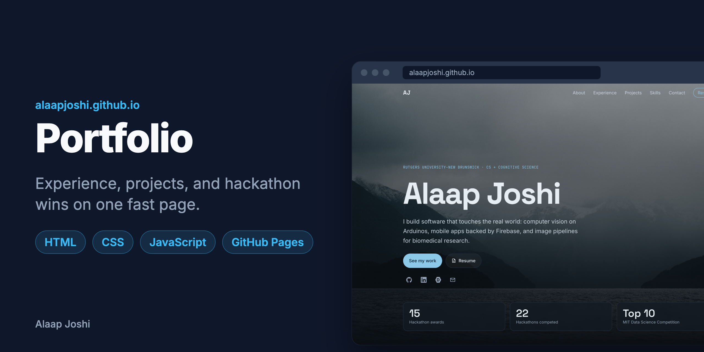
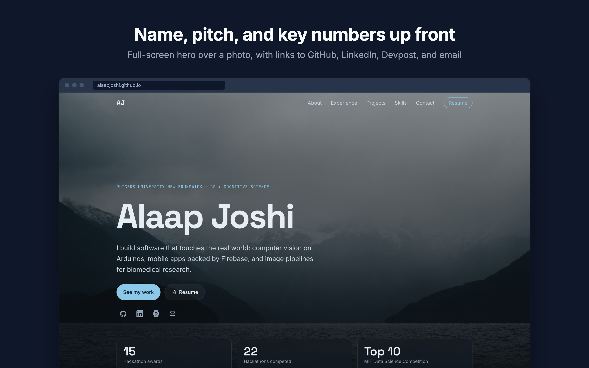
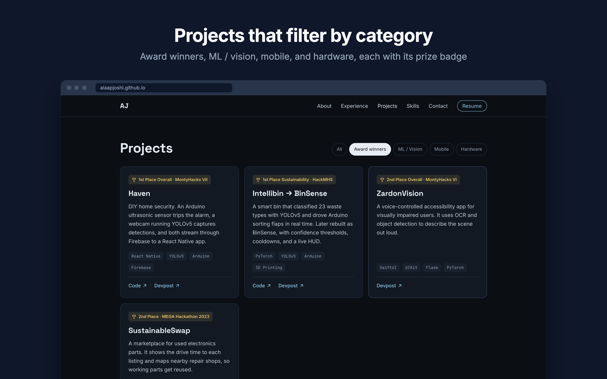
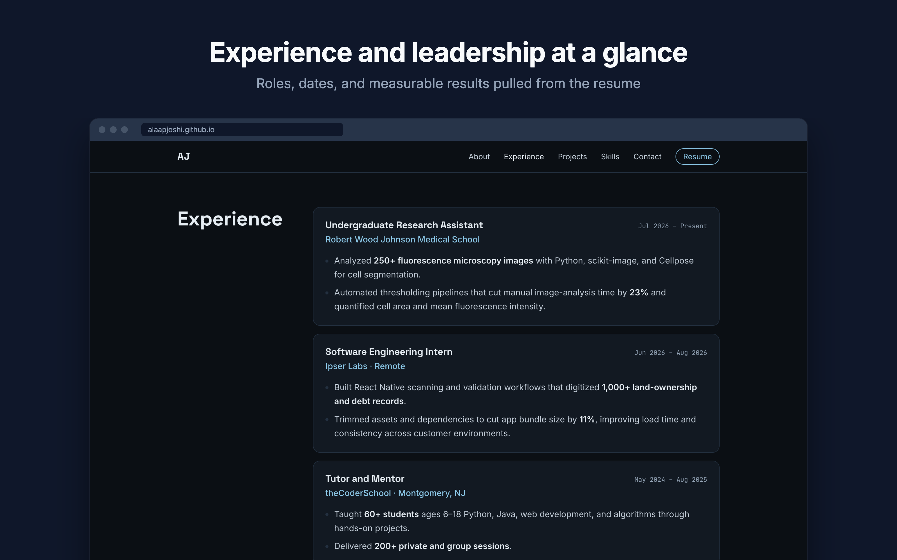
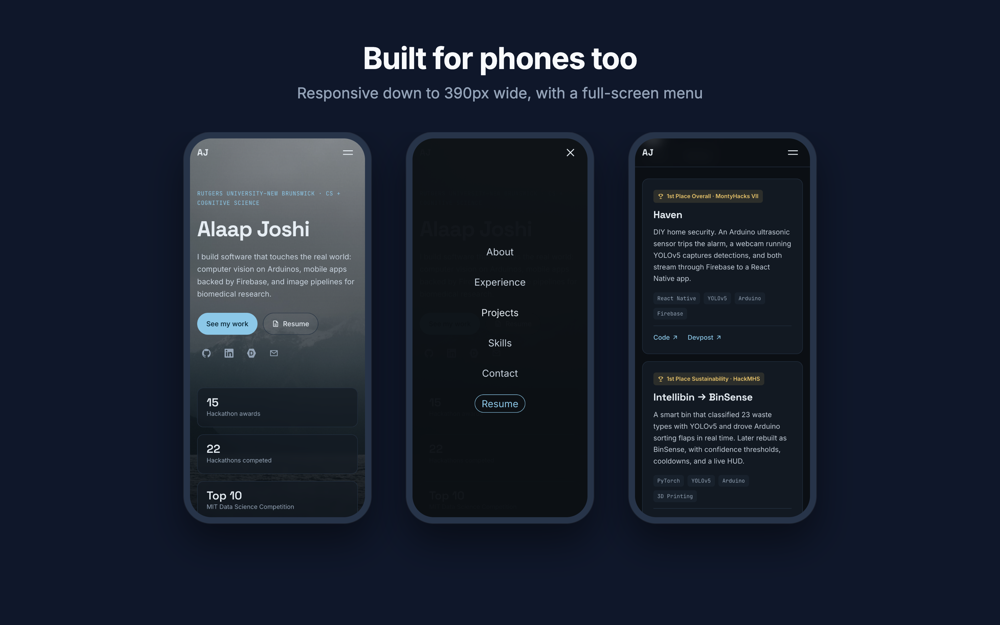

# alaapjoshi.github.io

> My personal portfolio site, so recruiters can see my experience, projects, and hackathon wins in one place.

   

## About
A resume lists projects, but it can't link to them or show what they look like. This site puts everything in one place: research and internship experience, award-winning hackathon projects with links to code and Devpost, and the tools I use. It's plain HTML, CSS, and JavaScript with no framework and no build step. The full content is in the HTML, so it loads fast, works without JavaScript, and is easy for search engines to read.

**Live:** [alaapjoshi.github.io](https://alaapjoshi.github.io)

## Features
- Shows my name, pitch, and key numbers (15 hackathon awards, 22 hackathons, Top 10 at MIT) on a full-screen hero.
- Filters projects by award winners, ML / vision, mobile, and hardware.
- Highlights the nav link for the section you're reading, and reveals sections as you scroll.
- Adapts to phones with a full-screen menu that closes with Escape or a tap.
- Tells search engines who the page is about with Open Graph tags, `Person` structured data, `robots.txt`, and `sitemap.xml`.
- Respects `prefers-reduced-motion` and includes a skip link and visible focus rings for keyboard users.

## Gallery
<table>
  <tr>
    <td width="50%"> The hero: name, pitch, profile links, and key numbers</td>
    <td width="50%"> Projects filtered to award winners</td>
  </tr>
  <tr>
    <td width="50%"> Experience cards with dates and results</td>
    <td width="50%"> The mobile layout and menu</td>
  </tr>
</table>

## Tech Stack
| Layer | Technology |
|---|---|
| Frontend | HTML5, CSS3 (custom properties, grid, flexbox), vanilla JavaScript |
| Fonts | Space Grotesk, Inter, JetBrains Mono (Google Fonts) |
| Hosting | GitHub Pages |
| Tools | Playwright (README images), VS Code |

## Getting Started

### Prerequisites
- Python 3 (or any static file server). Nothing to install.

### Installation
~~~bash
git clone https://github.com/alaapjoshi/alaapjoshi.github.io.git
cd alaapjoshi.github.io
~~~

### Usage
~~~bash
python3 -m http.server 8000
~~~
Open <http://localhost:8000>. Use a server rather than opening `index.html` directly, so the absolute paths in `404.html` resolve.

To update content:

| To change | Edit |
|---|---|
| Experience, projects, skills | the matching `<section>` in `index.html` |
| Which filters a project appears under | its `data-tags`, e.g. `data-tags="winner ml mobile"` |
| Colors and fonts | the `:root` variables at the top of `css/style.css` |
| The resume | replace `assets/Alaap_Joshi_Resume.pdf`, keeping the filename |

## Project Structure
~~~text
alaapjoshi.github.io/
  index.html      # All page content
  404.html        # Shown by GitHub Pages for missing URLs
  css/style.css   # Design tokens first, then one block per section
  js/main.js      # Nav, active-section highlight, scroll reveal, project filters
  img/            # Hero photo and favicon
  assets/         # Resume PDF
  docs/images/    # README cover and gallery (src/ holds the HTML they render from)
  robots.txt      # Lets crawlers index the site
  sitemap.xml     # Points search engines at the page
~~~

## How It Works
Everything a visitor or crawler needs is already in `index.html`. The stylesheet handles layout and the dark theme. `main.js` only adds behavior on top: it adds a `js` class to `<html>`, which turns on the scroll-reveal styles, so content never stays hidden if the script fails. The project filters read each card's `data-tags` and toggle its `hidden` attribute.

~~~mermaid
flowchart LR
  A[index.html all content] --> B[css/style.css layout + theme]
  A --> C[js/main.js menu, filters, reveal]
  C -->|toggles classes and hidden| A
  D[GitHub Pages] -->|serves| A
  E[robots.txt + sitemap.xml] -->|guide| F[Search engines]
  F --> D
~~~

## Future Improvements
- Add a page per project with its cover and gallery images.
- Serve the hero photo as WebP at multiple sizes to cut the first-load size.
- Run a GitHub Action that checks for broken links on every push.

## Author
**Alaap Joshi** - Computer Science + Cognitive Science, Rutgers University-New Brunswick
[GitHub](https://github.com/alaapjoshi) | [LinkedIn](https://linkedin.com/in/alaapjoshi)

## License
MIT. See [LICENSE](LICENSE).
